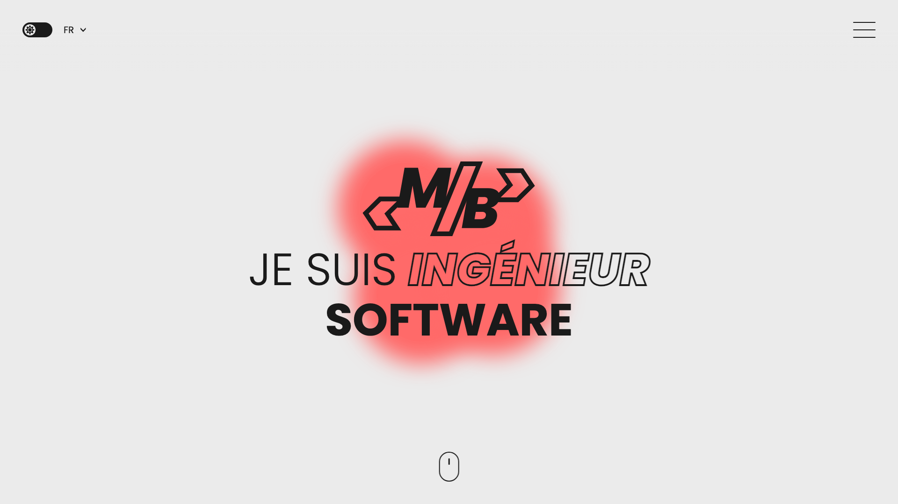

# Portfolio v4

My developer portfolio, fourth version.

A single-page website that introduces me, lists the projects I have built with a video preview of each, shows the technologies I use and gives ways to contact me. It is written for recruiters and clients, in French and English, with a light and a dark theme.



## Table of contents

- [Portfolio v4](#portfolio-v4)
	- [Table of contents](#table-of-contents)
	- [How it works](#how-it-works)
	- [Tech stack](#tech-stack)
	- [Repository structure](#repository-structure)
	- [Prerequisites](#prerequisites)
	- [Installation](#installation)
	- [Running locally](#running-locally)
	- [Useful scripts](#useful-scripts)
	- [Tests and quality](#tests-and-quality)
	- [License](#license)

## How it works

1. **Page layout**: `src/App.tsx` renders a navbar followed by six sections: home, about, projects, skills, contact and footer.
2. **Content**: projects and skills are declared in `src/assets`. Each project has a video, a link and a list of technologies. All texts are in `src/assets/lang.json`.
3. **Language**: the interface is available in French (default) and English. The selected language is kept in the state of `App` and passed down to each section.
4. **Theme**: the light or dark theme follows the operating system preference at load, and can be switched with a toggle. The `dark` class is set on the `body`.
5. **Navigation**: the navbar scrolls to the sections through refs. On screens narrower than 1024 px, it turns into a menu.
6. **Skills**: the skills section displays technology icons on a wheel that rotates automatically.
7. **Contact**: the contact section links to e-mail, LinkedIn, GitHub and Malt.

## Tech stack

| Layer | Technologies |
| --- | --- |
| Framework | React 18, Vite 4 (SWC) |
| Language | TypeScript |
| Styling | Tailwind CSS 3, PostCSS (`postcss-nesting`, Autoprefixer), `clsx`, `tailwind-merge` |
| Media | `react-player`, `react-waypoint`, `lucide-react` |
| Tooling | npm, ESLint, `tsc` |

## Repository structure

```
.
├── docs/                README screenshot
├── public/              Icon and sitemap
├── src/
│   ├── assets/          Texts, project videos, skill images, photo
│   ├── components/      Shared components (navbar, button, blob, project, ...)
│   │   ├── svg/         SVG components
│   │   └── toggle/      Language and theme toggles
│   ├── sections/        Page sections
│   ├── utils/           Breakpoints and class name helper
│   ├── App.tsx          Page, language, theme and viewport state
│   ├── index.css        Global styles and animations
│   └── main.tsx         Entry point
├── index.html           HTML entry (fonts loaded from Google Fonts)
├── tailwind.config.js
└── vite.config.ts
```

One file per component or section, named in kebab case. Props are passed down from `App`, there is no global store. Code is indented with four spaces.

## Prerequisites

- [Node.js](https://nodejs.org/) 16 or later (required by Vite 4)
- npm
- A network connection, since the fonts are loaded from Google Fonts

## Installation

```bash
git clone git@github.com:maxencebonamy/Portfolio-v4.git
cd Portfolio-v4
npm install
```

## Running locally

```bash
npm run dev
```

The site is served on <http://localhost:5173>.

To build and serve the production version:

```bash
npm run build
npm run preview
```

## Useful scripts

| Command | Effect |
| --- | --- |
| `npm run dev` | Start the Vite development server |
| `npm run build` | Type-check with `tsc`, then build into `dist/` |
| `npm run preview` | Serve the production build |
| `npm run lint` | Lint `ts` and `tsx` files, failing on any warning |

## Tests and quality

The project has no automated tests. Code quality is checked with ESLint and the TypeScript strict mode.

```bash
npm run lint
```

## License

This project is licensed under the [MIT License](LICENSE).
